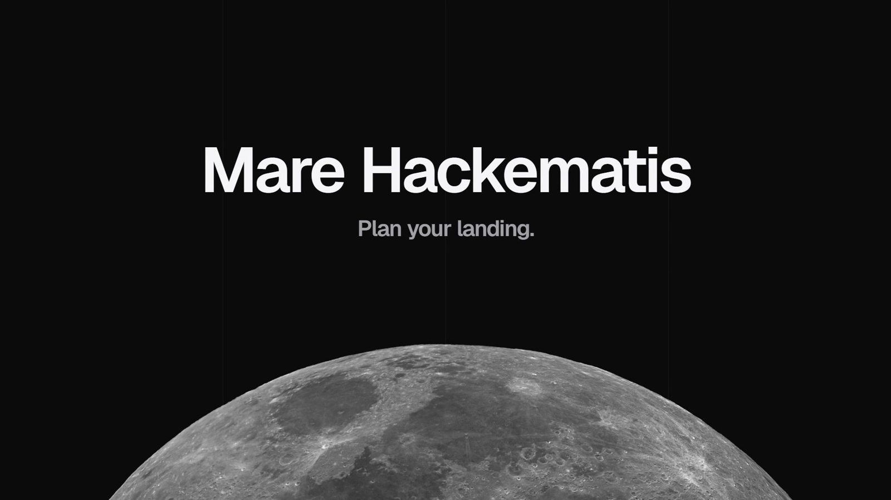
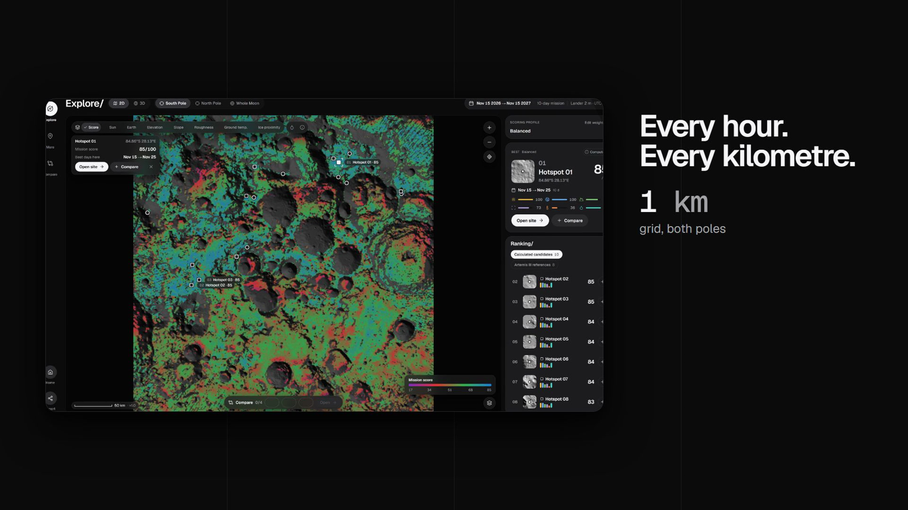
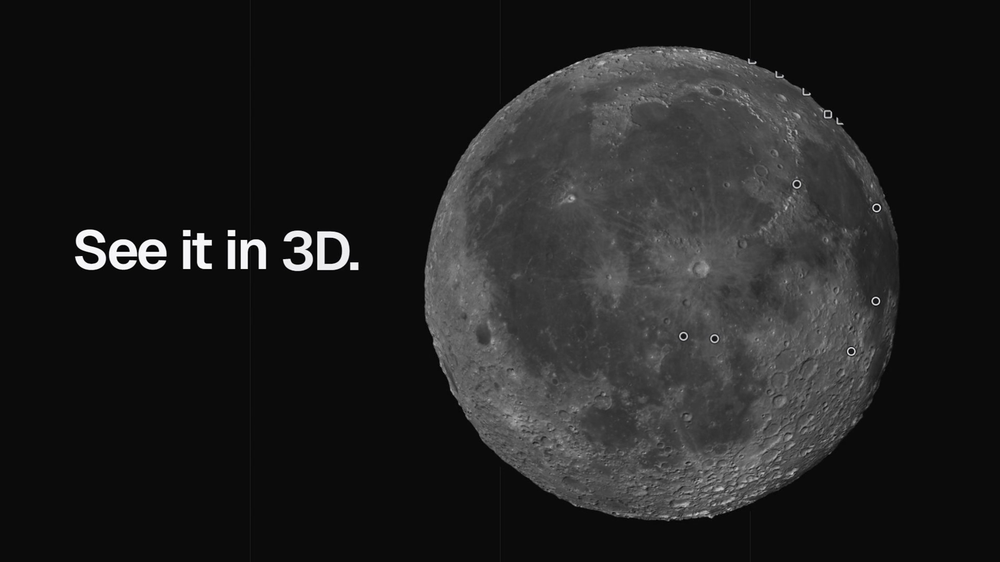
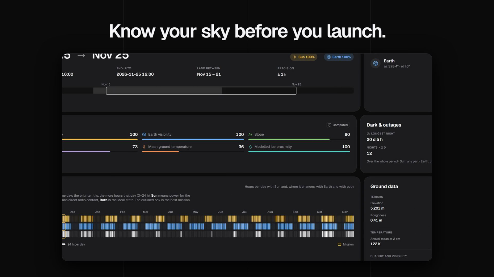
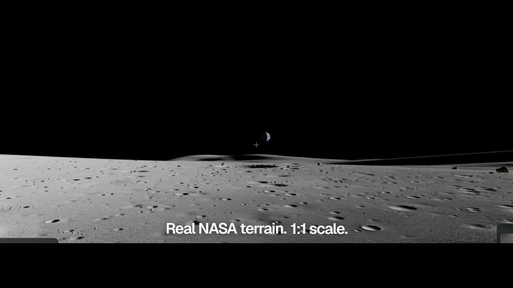
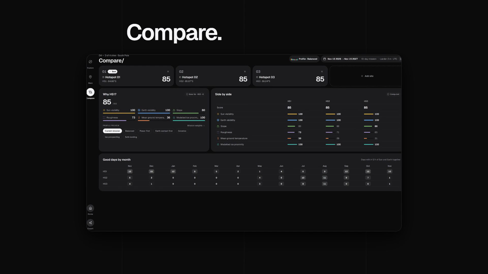

# Mare Hackematis

**Plan your landing.**



Mare Hackematis turns lunar data into an interactive mission plan. Choose where to land, when to go and what matters most, then explore candidate sites, understand their scores and walk across the lunar surface in 3D.

Built by **Team Hackemate** for the **NASA Space Apps Challenge 2026**, it brings mission planning and immersive exploration together in a static web app. Mission calculations run in your browser, using terrain and observation data from NASA and ephemerides from NASA/JPL.

[Watch the demo](#demo) · [Explore the features](#from-mission-plan-to-lunar-surface) · [Run locally](#run-locally) · [Technical guide](docs/DEVELOPMENT.md)

## Demo

https://github.com/user-attachments/assets/b53d5b4e-047f-48d9-bf49-6c092c4806aa

[Watch or download the original 1080p video](docs/media/MareHackematis.mp4) · 30 seconds

## From mission plan to lunar surface

1. **Where?** Choose the South Pole, North Pole or Whole Moon.
2. **When?** Set a landing date and mission duration, or search a landing window at either pole.
3. **How?** Adjust mission priorities: sunlight, Earth visibility, slope, roughness, ground temperature and modelled ice proximity.
4. **Explore and compare.** Find promising areas, inspect the reasoning behind each score and compare candidate sites before opening a surface view.


### Explore every kilometre

Polar maps use a **1 km × 1 km grid**. Switch between scientific layers, inspect ranked hotspots and see how dates, priorities and terrain constraints change the result. The Whole Moon view adds global exploration at a coarser resolution.



### See the Moon in 3D

Rotate the lunar globe, explore photographic imagery and relief, and move from a global view to individual regions.



### Know your sky before you launch

Inspect sunlight, Earth visibility, periods of darkness and mission timelines. The site view explains the conditions behind the score so you can understand why a location fits your plan.



### Then walk it

**Astronaut Mode** lets you explore terrain in first person, with lunar gravity, time controls and Sun/Earth positions from ephemerides. NASA elevation data provide the large-scale terrain; small craters and decorative rocks add procedural detail.



### Compare. Decide. Land.

Compare candidate sites side by side, review each scoring factor and see how different mission profiles change the trade-offs.



*Images are frames from the project demonstration video.*

## Built on lunar data

- **NASA LOLA:** elevation, terrain horizons, slope, roughness and permanent shadow.
- **NASA/JPL SPICE:** Sun and Earth geometry for the selected mission dates.
- **LRO Diviner:** ground temperature and polar resource modelling.
- **LROC WAC:** photographic lunar imagery.
- **JPL Horizons:** reference comparisons for the ephemeris validation pipeline.

The app combines these sources into explainable scores that respond to the selected mission. Data resolution and available layers vary by region; see the [architecture and sources](docs/ARCHITECTURE.md) and [Astronaut Mode documentation](docs/ASTRONAUT_MODE.md) for the methods and scientific limits.

## Run locally

Requirements: **Node.js 18+**, **Git** and **Git LFS**.

```bash
git lfs install
git clone https://github.com/MrRexos/mare-hackematis.git
cd mare-hackematis
git lfs pull
cd web
npm install
npm run dev
```

Open [http://localhost:5173](http://localhost:5173). The generated web data are included, so you can explore without rebuilding the Python pipeline.

**Stack:** React · Vite · Three.js · Rapier · Python · NumPy · SPICE

For data regeneration, validation commands, polar datasets and global layers, see the [development guide](docs/DEVELOPMENT.md). The shared data format is described in the [data contract](docs/DATA_CONTRACT.md).

## Team and project origin

Created by **Team Hackemate**, computer engineering students at **FIB**:

Oier Hernanz · Victor Puy · Pol Salvador · Nil Font · Jan Tarriño · Joel Susi

This repository is an independent copy of the team's [NASA-Space-Apps-2026 repository](https://github.com/joeel14/NASA-Space-Apps-2026), preserving its Git history and contributor attribution.
